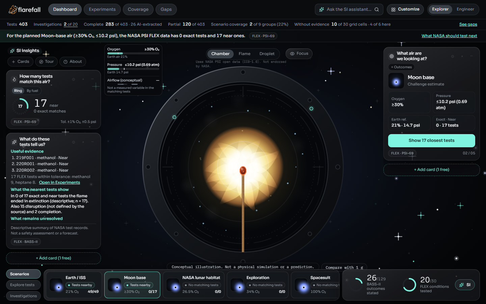
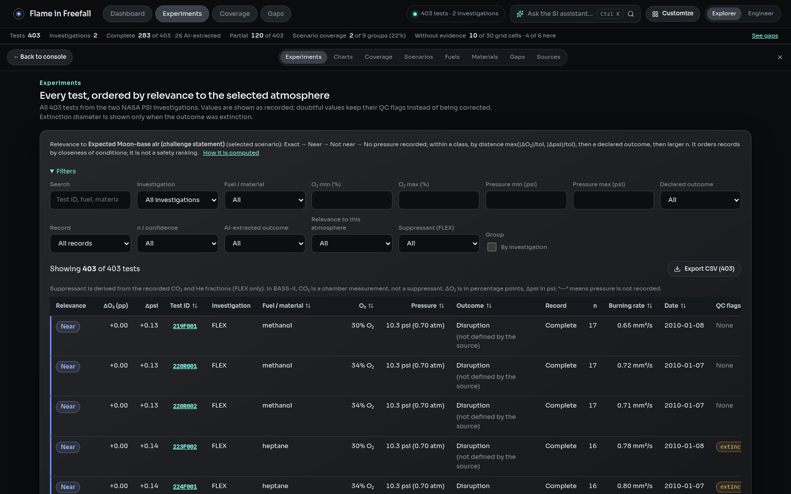

# Flarefall

**An evidence map, not a guess: it shows what NASA's microgravity combustion data can and cannot tell a Moon-base designer.**

Flarefall is an interactive dashboard built for the NASA Space Apps Challenge 2026 challenge *Flame in Freefall*.
It organises **403 fire tests run on the International Space Station** (274 FLEX fuel-droplet tests and 129 BASS-II
solid-material tests, from NASA Physical Sciences Informatics) by cabin atmosphere. For each atmosphere it shows which
tests are closest, how they ended, what is covered, what is missing, and which investigations NASA has run on each
fire-safety pillar (prevention, detection, suppression).

**Main finding:** for the Moon-base air expected in the challenge (30% O₂ or more at 10.2 psi or less) the FLEX data has
**0 exact tests and 17 near ones**, and no FLEX test below 10.18 psi or between 25% and 30% O₂. All PSI data are
microgravity: there is no partial-gravity (Moon or Mars) combustion data yet.

| Dashboard (Moon-base air) | Experiments ordered by relevance |
|---|---|
|  |  |

Every number on the site is computed from the data files and shows its sample size (n) and source DOI. The site is
descriptive: **no safety rating, no risk score, no forecast.** Where there is no test it says "No data".

## Run it

```bash
cd frontend
npm ci
npm run dev        # http://127.0.0.1:5173  (add ?intro=off to skip the opening animation)
npm run build      # static site in frontend/dist, works on any static host (relative paths)
npm test
```

Optional Python pipeline and API (Python 3.12):

```bash
python -m venv .venv && .venv/bin/pip install -r requirements-dev.txt   # Windows: .venv\Scripts\pip
python scripts/build_experiments.py          # rebuilds data/processed/psi.sqlite from the CSVs (no network)
python -m pytest
```

Full setup, data regeneration and the optional local assistant (Ollama): [`docs/SETUP.md`](docs/SETUP.md).

## Repository

```
frontend/          React + TypeScript site (Vite). public/data/*.json = the data the site reads
src/               Python: read-only queries over SQLite, scenarios, relevance, optional FastAPI backend
scripts/           data pipeline (fetch, process, build), audit_numbers.py (independent recomputation), smoke tests
data/processed/    processed tables (CSV, JSON) built from the NASA files
tests/             Python tests
docs/              setup, data dictionary, API, data sources, AI use, challenge text
```

## Data and licences

- **Data:** NASA Physical Sciences Informatics, **CC0-1.0**. FLEX (PSI-69) DOI
  [10.60555/mbq8-0451](https://doi.org/10.60555/mbq8-0451) · BASS-II (PSI-25) DOI
  [10.60555/4qc4-de67](https://doi.org/10.60555/4qc4-de67). Details: [`docs/DATA_SOURCES.md`](docs/DATA_SOURCES.md),
  column definitions: [`docs/data-dictionary.md`](docs/data-dictionary.md).
- **Code:** Apache-2.0 ([`LICENSE`](LICENSE)). Third-party software and fonts: [`THIRD_PARTY.md`](THIRD_PARTY.md).

## Use of AI

AI tools (Anthropic Claude) wrote most of the code, tests and documentation under the team's direction. BASS-II outcomes
and air speeds extracted by AI from free-text notes are labelled "AI-extracted" in the data and on the site. The logo was
generated with Gemini. Full statement: [`docs/AI_USAGE.md`](docs/AI_USAGE.md).

## Limits

Microgravity on the ISS only (no partial-gravity data in PSI). FLEX extinction shares are descriptive, not probabilities.
Cells with n < 5 carry a warning. CO₂ and helium effects are confounded with oxygen. "Disruption" is not defined by the
source. BASS-II records no pressure and 103 of 129 of its tests have no stated outcome ("not stated" does not mean the
flame went out). These are exploratory findings by a student team, not NASA guidance.

## Team

Stars Rippers, Universidad Politécnica de Querétaro (UPQ), NASA Space Apps Challenge 2026, UNAQ (Querétaro).
Uses NASA open data. **Not endorsed by NASA.**
