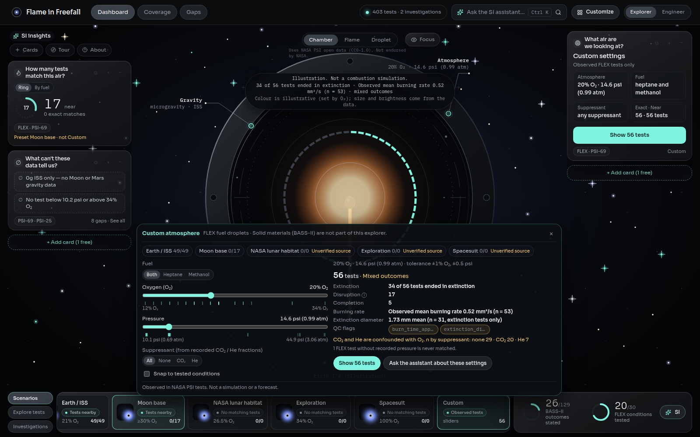
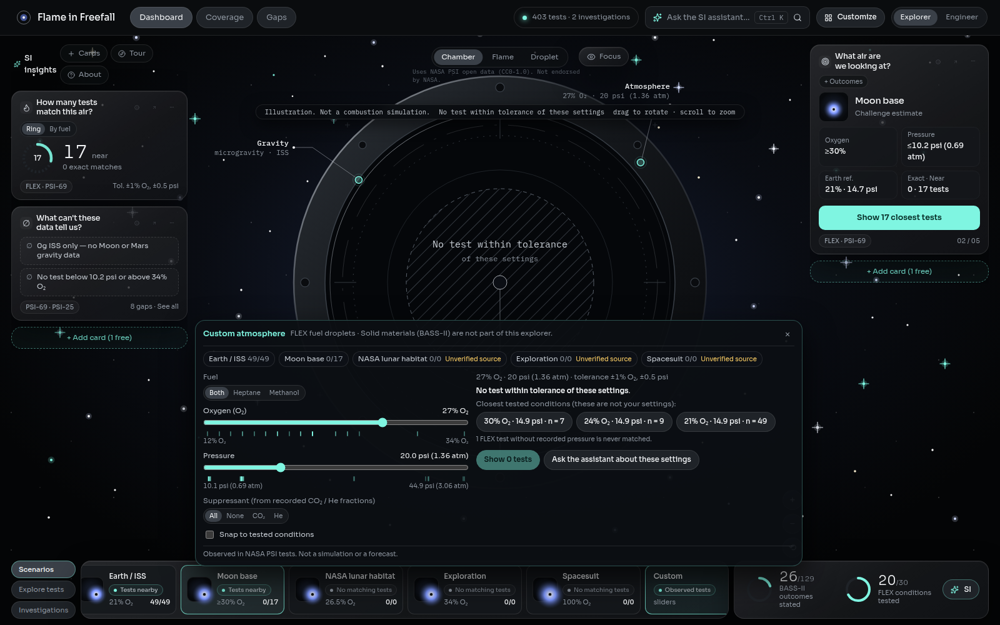
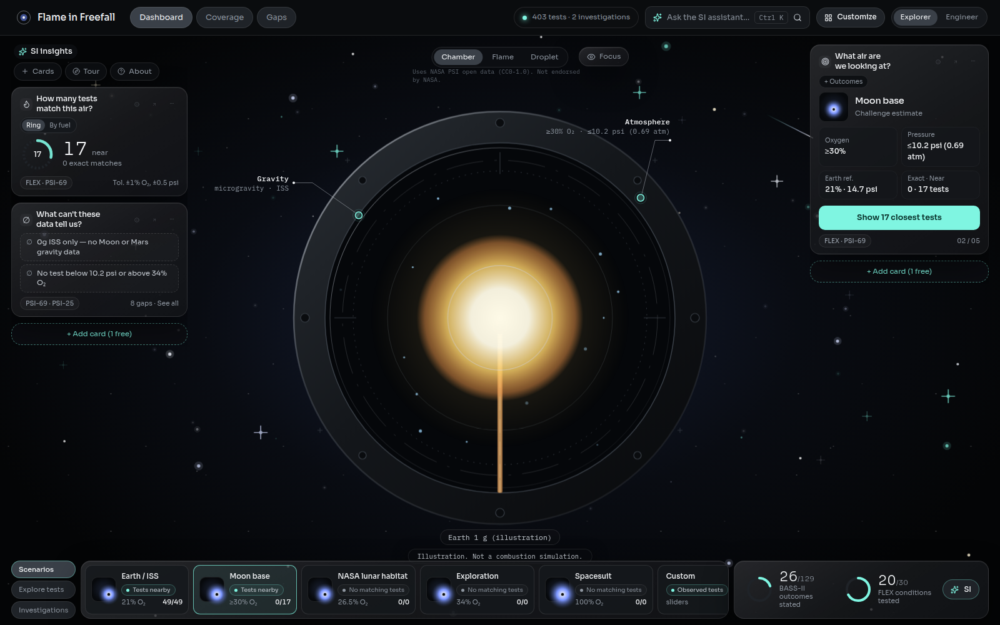
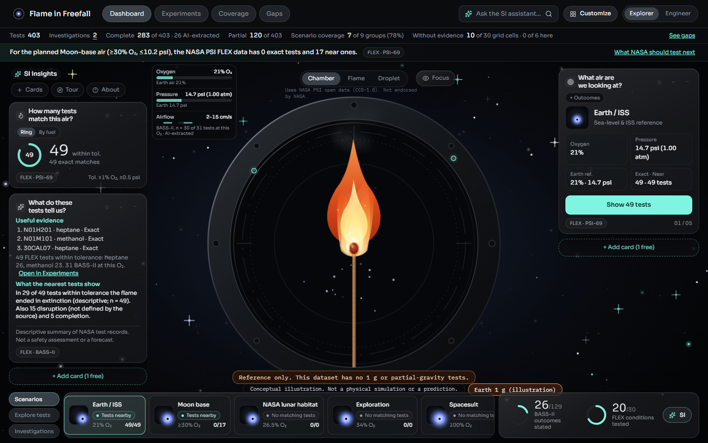

# 🔥 Stars Rippers — Flame in Freefall Explorer

NASA Space Apps Challenge 2026 · UNAQ (Querétaro) · Challenge: *Flame in Freefall: AI-Powered Fire Safety Insights from Microgravity Combustion Data*.
Independent student project (Universidad Politécnica de Querétaro). **Not endorsed by NASA.**

## What it is
An evidence-first dashboard for NASA microgravity combustion data (NASA PSI: **FLEX** PSI-69 and **BASS-II** PSI-25, 403 ISS tests),
organised by cabin atmosphere (oxygen and pressure). It shows how many real tests are near an atmosphere (Earth/ISS air, the expected
Moon-base air, …), how they ended, and what is missing. For the expected Moon-base air (≥30% O₂, ≤10.2 psi) there are **0 exact tests
and 17 near tests**. Every number carries its sample size (n) and source DOI; cells with n < 5 are flagged. An optional SI ("Super
Intelligence", i.e. an AI/LLM) assistant answers only from these data and says "No data" otherwise.

| Custom explorer: observed tests only | No test within tolerance |
|---|---|
|  |  |
|  |  |

## Run it
**1. Static site only (what is published; no backend, no AI model)**
```bash
cd frontend && npm ci && npm run build      # → frontend/dist (drag it to any static host; see docs/submission/DEPLOY.md)
npm run preview                             # http://127.0.0.1:4173
```
**2. With the API (demo laptop)**
```bash
python3 -m venv .venv && source .venv/bin/activate && pip install -r requirements-dev.txt
python scripts/build_experiments.py         # regenerates psi.sqlite from data/processed/*.csv (no network)
uvicorn backend.app:app --app-dir src --host 127.0.0.1 --port 8000      # OpenAPI at /docs
cd frontend && VITE_LLM_URL=http://127.0.0.1:8000 npm run dev           # http://127.0.0.1:5173
```
**3. With local models (optional, Ollama)**: `ollama pull llama3.2:3b`, `ollama pull qwen3:8b`, `ollama pull qwen3:14b`; then **Connect local AI** in
the SI panel. Tested on the demo laptop (24 GB RAM, 4 GB GPU): `llama3.2:3b` (Flash) and `qwen3:8b` (Medium) ran; `qwen3:14b` (Heavy) was **not downloaded** (disk space) and was not evaluated. Results and limits: `docs/bench/RESUMEN.md`, `docs/bench/DIAGNOSTICO.md`. Without them the site works in Basic mode.
Environment variables and troubleshooting: `docs/SETUP.md` §7.

**Checks:** `python -m pytest` · `cd frontend && npm test && npm run build` · `python scripts/audit_numbers.py` ·
`python scripts/smoke_e2e.py` · `node scripts/check_static_site.mjs` (needs `playwright-core`, not a dependency).

## Folder map
```
frontend/            React + Vite + TypeScript site (public/data/*.json are generated, never edited by hand)
src/psi_queries.py   the only place with SQL (read-only SQLite); src/scenarios.py atmosphere scenarios
src/backend/         FastAPI: routes, closed tool list, scope rules, verifier, Ollama client
scripts/             data pipeline, build_frontend_data.py, audit_numbers.py, smoke/bench/static checks
data/processed/      versioned tables (experiments.csv, 403 rows); data/raw is local and git-ignored
tests/               pytest (API, scope, guardrails with a fake model, data); frontend tests live in frontend/src
docs/                data dictionary, API contract, decisions, AI log, submission/ (form drafts, demo plan, deploy)
```

## Data and licenses
- **Data:** NASA Physical Sciences Informatics, **CC0-1.0**: FLEX DOI [10.60555/mbq8-0451](https://doi.org/10.60555/mbq8-0451), BASS-II DOI [10.60555/4qc4-de67](https://doi.org/10.60555/4qc4-de67). All tests are microgravity on the ISS.
- **Code:** Apache-2.0 (`LICENSE`). Third-party licenses: `THIRD_PARTY.md`.

## Use of AI
Much of the code, documentation and UI text was generated with AI assistants (Anthropic Claude via Claude Code and claude.ai). The log
records each task, the model, and what review is still pending: `docs/AI_USAGE_LOG.md`; summary: `docs/submission/use_of_si.md`.
BASS-II outcomes were extracted by AI from free-text notes and are labelled (`ai_*`, `extracted_by=AI`, `outcome_source = ai_extracted`).
Commits with AI-generated changes carry `AI-assisted: yes`.

## Limits (read before quoting a number)
No predictive model and no safety rating. FLEX extinction percentages are descriptive, not probabilities. There is no partial-gravity or
normal-gravity data. CO₂/He effects are confounded with O₂. In BASS-II, "not stated" does not mean the flame did not go out. "Disruption"
is not defined by the source. Three atmosphere sources are marked "Unverified source". Details: `docs/data-dictionary.md`, `docs/03-analisis-datos.md`.

## Team documents (Spanish)
| File | Purpose |
|---|---|
| `docs/00-reglas-y-checklist.md` | Rules, dates, submission requirements |
| `docs/02-roles.md`, `docs/tareas/` | Who does what |
| `docs/03-analisis-datos.md` | Data analysis and interpretation rules |
| `docs/07-api-contract.md` | API contract (backend ↔ frontend) |
| `docs/DECISIONES.md` | Decision log · `docs/HANDOFF.md` current state |
| `docs/maintenance/CLEANUP_REPORT.md` | What was deleted and why |
| `CLAUDE.md`, `.claude/skills/` | Instructions given to the AI assistants |

Team: Stars Rippers — students of ITIID, Universidad Politécnica de Querétaro (UPQ). Mentor: Dra. Argelia.
